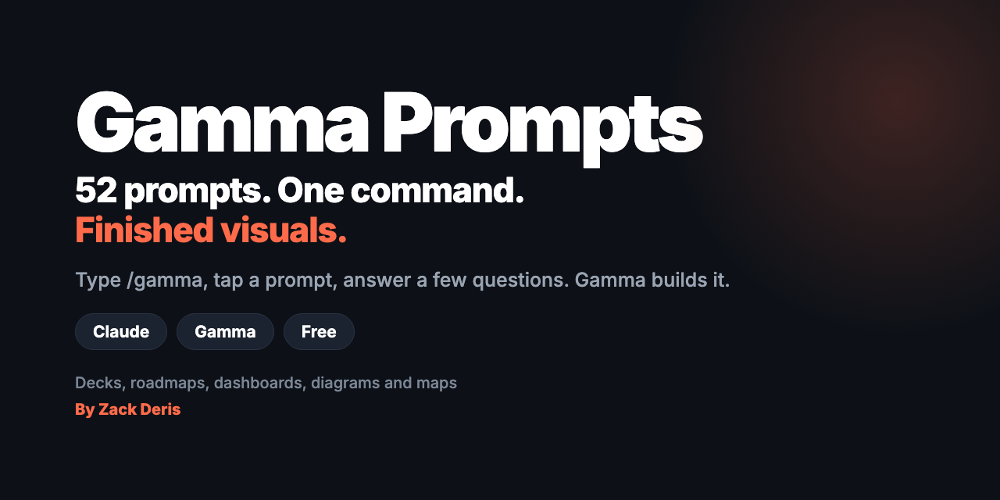
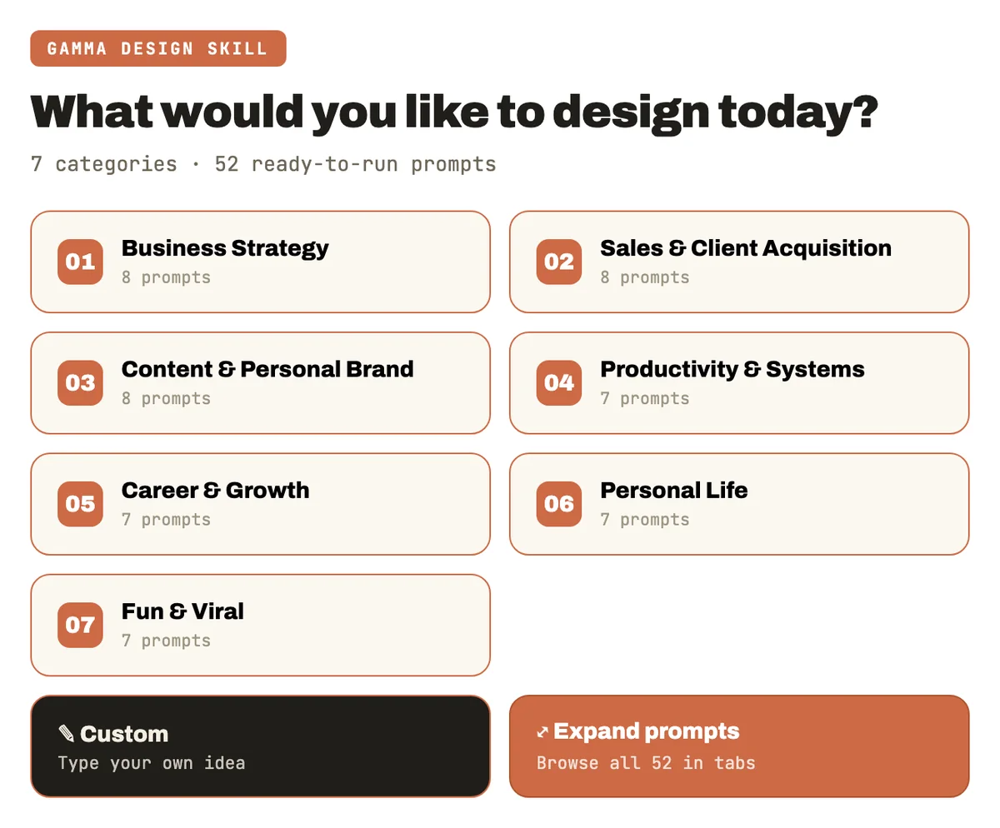
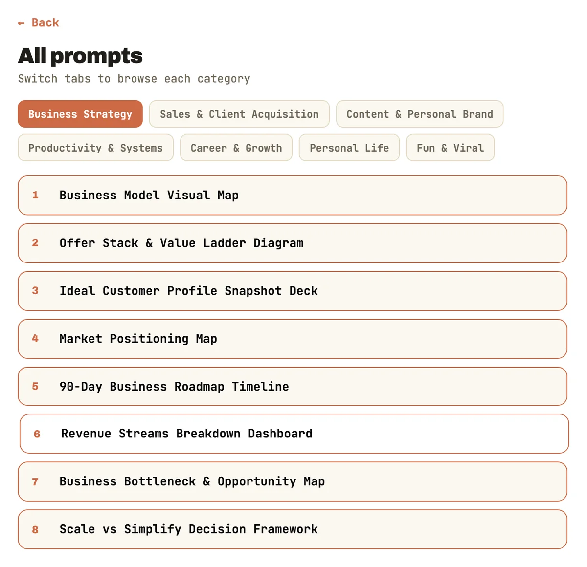
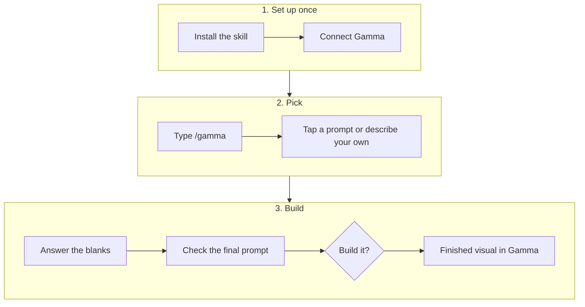
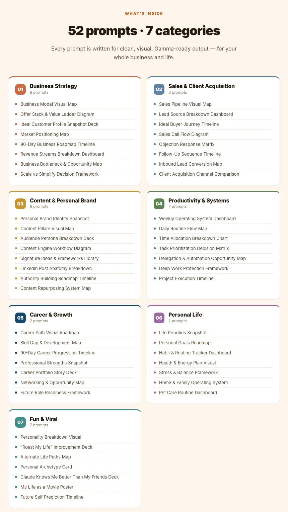

<p align="center">
  
</p>

<p align="center">
  <a href="../../releases/latest"></a>
  
  
  
</p>

<p align="center">
  <a href="https://zackderis.com/gamma/skill"><b>Website</b></a> ·
  <a href="docs/prompts.md"><b>All 52 prompts</b></a> ·
  <a href="../../releases/latest"><b>Download</b></a> ·
  <a href="https://zackderis.com/book-a-call"><b>Book a call</b></a>
</p>

**The Gamma Prompt Library is a free Claude skill that turns 52 proven prompts into finished visuals.** Type `/gamma`, tap what you want from a visual menu, answer a few quick questions and Gamma builds it: a deck, roadmap, dashboard, diagram or map.

No more opening a doc, hunting for a prompt, pasting it into a chat and editing the blanks by hand. It all happens in one conversation.

## Contents

- [The menu](#the-menu)
- [How it works](#how-it-works)
- [What's inside](#whats-inside)
- [Quick start](#quick-start)
- [What you need](#what-you-need)
- [How it stays accurate](#how-it-stays-accurate)
- [FAQ](#faq)
- [What's in this repo](#whats-in-this-repo)
- [About](#about)

## The menu

<table>
  <tr>
    <td width="50%"></td>
    <td width="50%"></td>
  </tr>
  <tr>
    <td align="center"><b>Pick a category</b></td>
    <td align="center"><b>Or browse all 52 in tabs</b></td>
  </tr>
</table>

## How it works



| Step | What the skill does | What you do |
|---|---|---|
| **Menu** | Opens the visual menu in your chat | Tap a category, browse all, or choose Custom |
| **Prompt** | Finds the exact prompt in the library | Nothing |
| **Blanks** | Asks for every bracket, such as your industry or offer | Answer in a few words |
| **Confirm** | Shows the completed prompt | Edit it, or say yes |
| **Build** | Sends it to Gamma through the connector | Open and edit the result in Gamma |

Choosing **Custom** writes a brand-new prompt in the same style from your own idea.

## What's inside

| # | Category | Prompts | Examples |
|---|---|---|---|
| 1 | Business Strategy | 8 | Business Model Visual Map, 90-Day Business Roadmap Timeline |
| 2 | Sales & Client Acquisition | 8 | Sales Pipeline Visual Map, Objection Response Matrix |
| 3 | Content & Personal Brand | 8 | Content Pillars Visual Map, LinkedIn Post Anatomy Breakdown |
| 4 | Productivity & Systems | 7 | Weekly Operating System Dashboard, Task Prioritization Decision Matrix |
| 5 | Career & Growth | 7 | Career Path Visual Roadmap, Skill Gap & Development Map |
| 6 | Personal Life | 7 | Life Priorities Snapshot, Habit & Routine Tracker Dashboard |
| 7 | Fun & Viral | 7 | "Roast My Life" Improvement Deck, My Life as a Movie Poster |

**[See all 52 prompts →](docs/prompts.md)**

<p align="center">
  
</p>

## Quick start

1. **[Download `gamma.zip`](../../releases/latest).**
2. At [claude.ai](https://claude.ai), go to **Customize → Skills → Add → Upload skill**, and upload the zip.
3. Go to **Customize → Connectors** and connect **Gamma**.
4. Open a new chat and type `/gamma`.

Prefer to copy and paste? The prompts are also on [zackderis.com/gamma/claude](https://zackderis.com/gamma/claude), and there's a [ChatGPT version](https://zackderis.com/gamma/chatgpt).

## What you need

| Need | Details |
|---|---|
| **Claude** | A plan that supports skills: Pro, Max, Team or Enterprise. |
| **[Gamma](https://gamma.app/?utm_campaign=prompt&utm_content=Zack+Deris&utm_source=LinkedIn)** | An account, connected to Claude. Each build uses your Gamma credits. |

## How it stays accurate

- **Prompts are used word for word.** Only the brackets change.
- **Every blank gets a real answer.** It asks you instead of guessing.
- **You approve before it builds.** The completed prompt is shown first.

Many prompts begin "based on everything you know about me", so the output improves when Claude already has context about you. Check names, numbers and claims before you share a visual.

## FAQ

<details><summary><b>Is it really free?</b></summary>

Yes. You pay only for your Claude plan and the Gamma credits you use.
</details>

<details><summary><b>Can I edit the visual afterwards?</b></summary>

Yes. It's a normal Gamma project, so you can change the text, layout and theme there.
</details>

<details><summary><b>Can I add my own prompts?</b></summary>

Yes. Add them to `gamma/references/prompt-library.md` in your copy. To show them in the menu, update `gamma/assets/gamma-menu.html` too. Or use Custom for one-off ideas.
</details>

<details><summary><b>Why doesn't tapping the menu do anything?</b></summary>

The menu needs Claude's interactive view to send your choice back to the chat. If taps don't register, just type the category or prompt name.
</details>

<details><summary><b>Can I use it for my clients?</b></summary>

Yes. You can use and edit it for your own business and for clients you serve. You can't resell or redistribute it. See the [license](LICENSE).
</details>

<details><summary><b>I found a bug. Where do I report it?</b></summary>

[Open an issue](../../issues) with the prompt you were using.
</details>

## What's in this repo

```
gamma/
  SKILL.md             How the skill runs
  references/          The full text of all 52 prompts
  assets/              The interactive menu
docs/                  The prompt list and images
CHANGELOG.md           What's new
LICENSE                What you can and can't do with it
```

To package your own edited copy, run:

```bash
mkdir -p dist && zip -r dist/gamma.zip gamma
```

## About

Built by **[Zack Deris](https://zackderis.com)**, AI Sales Systems Consultant. In sales since 2009, now building AI-powered outbound systems for B2B founders and teams.

**Want AI systems built for your team?** [Book a call](https://zackderis.com/book-a-call).

[LinkedIn](https://www.linkedin.com/in/zdnft) · [YouTube](https://www.youtube.com/@zackderis) · [X](https://x.com/zackydzz)

More free skills: [GTMAI](https://github.com/Zackderis/gtmai) · [OutboundOS](https://github.com/Zackderis/outboundos) · [AI SDR](https://github.com/Zackderis/ai-sdr)

Free for your own business and your clients, not for resale or redistribution. See [LICENSE](LICENSE). The Gamma link above is a partner link, so Zack may earn a commission or credit if you sign up through it, at no cost to you. This library isn't affiliated with or endorsed by Anthropic or Gamma.
