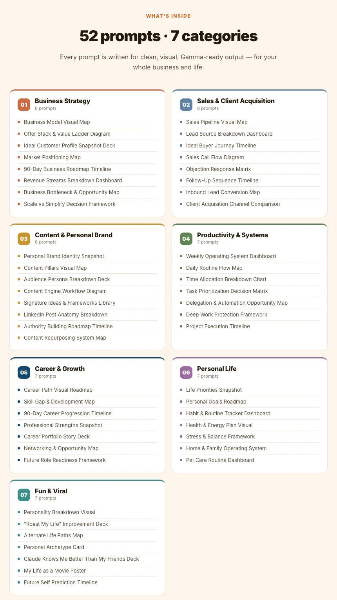

# All 52 prompts

The full text of every prompt is in [`gamma/references/prompt-library.md`](../gamma/references/prompt-library.md). [Back to the README](../README.md)

## 1. Business Strategy (8 prompts)

- **1.1** Business Model Visual Map
- **1.2** Offer Stack & Value Ladder Diagram
- **1.3** Ideal Customer Profile Snapshot Deck
- **1.4** Market Positioning Map
- **1.5** 90-Day Business Roadmap Timeline
- **1.6** Revenue Streams Breakdown Dashboard
- **1.7** Business Bottleneck & Opportunity Map
- **1.8** Scale vs Simplify Decision Framework

## 2. Sales & Client Acquisition (8 prompts)

- **2.1** Sales Pipeline Visual Map
- **2.2** Lead Source Breakdown Dashboard
- **2.3** Ideal Buyer Journey Timeline
- **2.4** Sales Call Flow Diagram
- **2.5** Objection Response Matrix
- **2.6** Follow-Up Sequence Timeline
- **2.7** Inbound Lead Conversion Map
- **2.8** Client Acquisition Channel Comparison

## 3. Content & Personal Brand (8 prompts)

- **3.1** Personal Brand Identity Snapshot
- **3.2** Content Pillars Visual Map
- **3.3** Audience Persona Breakdown Deck
- **3.4** Content Engine Workflow Diagram
- **3.5** Signature Ideas & Frameworks Library
- **3.6** LinkedIn Post Anatomy Breakdown
- **3.7** Authority Building Roadmap Timeline
- **3.8** Content Repurposing System Map

## 4. Productivity & Systems (7 prompts)

- **4.1** Weekly Operating System Dashboard
- **4.2** Daily Routine Flow Map
- **4.3** Time Allocation Breakdown Chart
- **4.4** Task Prioritization Decision Matrix
- **4.5** Delegation & Automation Opportunity Map
- **4.6** Deep Work Protection Framework
- **4.7** Project Execution Timeline

## 5. Career & Growth (7 prompts)

- **5.1** Career Path Visual Roadmap
- **5.2** Skill Gap & Development Map
- **5.3** 90-Day Career Progression Timeline
- **5.4** Professional Strengths Snapshot
- **5.5** Career Portfolio Story Deck
- **5.6** Networking & Opportunity Map
- **5.7** Future Role Readiness Framework

## 6. Personal Life (7 prompts)

- **6.1** Life Priorities Snapshot
- **6.2** Personal Goals Roadmap
- **6.3** Habit & Routine Tracker Dashboard
- **6.4** Health & Energy Plan Visual
- **6.5** Stress & Balance Framework
- **6.6** Home & Family Operating System
- **6.7** Pet Care Routine Dashboard

## 7. Fun & Viral (7 prompts)

- **7.1** Personality Breakdown Visual
- **7.2** "Roast My Life" Improvement Deck
- **7.3** Alternate Life Paths Map
- **7.4** Personal Archetype Card
- **7.5** Claude Knows Me Better Than My Friends Deck
- **7.6** My Life as a Movie Poster
- **7.7** Future Self Prediction Timeline
